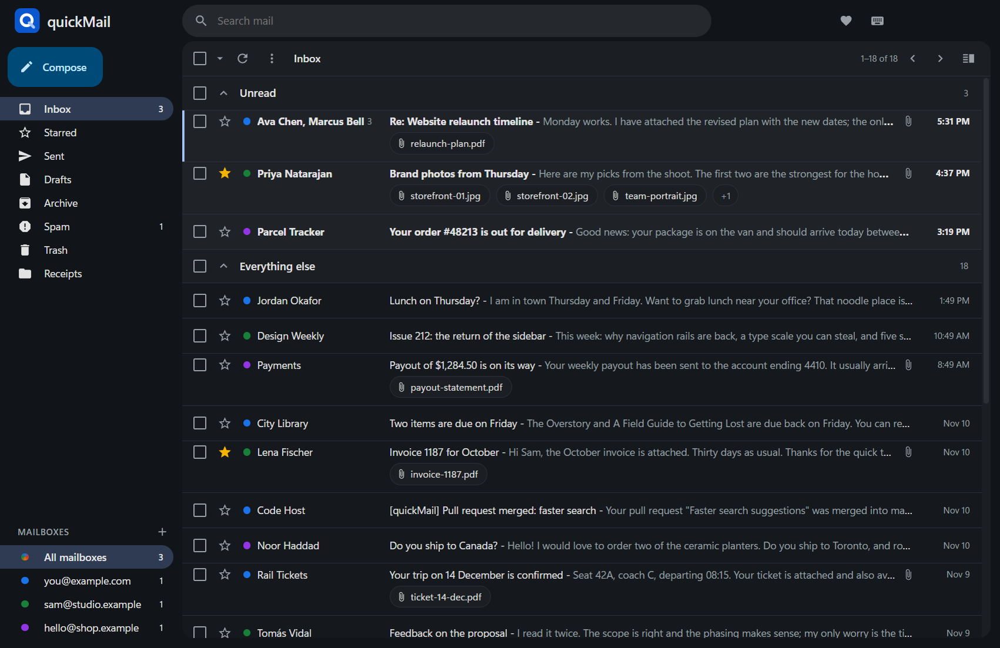
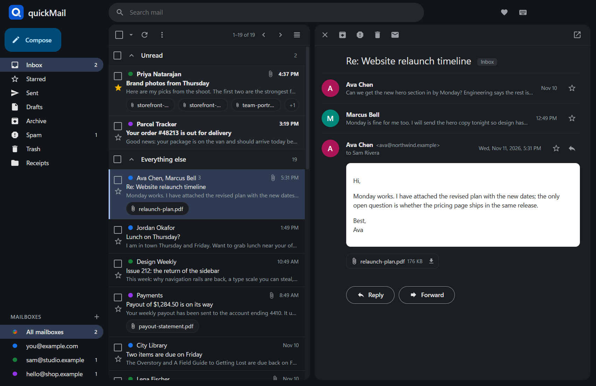
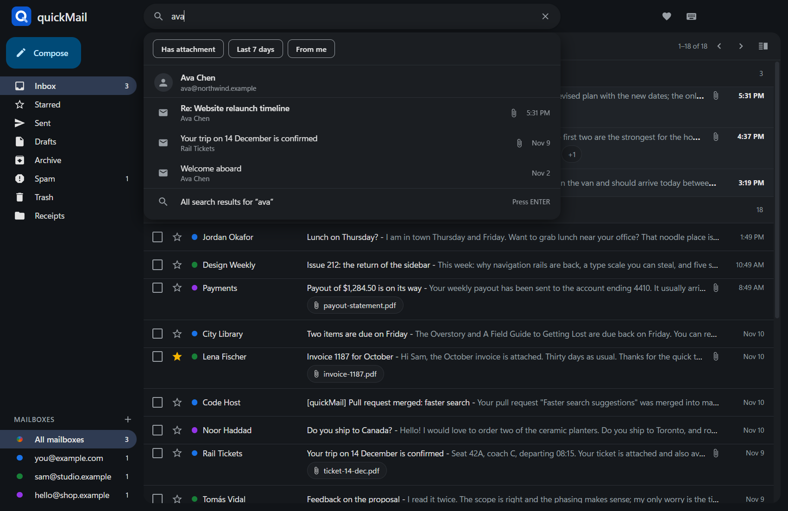

# quickMail

A fast, Gmail-style mail client for Windows (with new macOS and Linux builds), plus a command-line tool (`quickmail`, alias `qm`) that AI agents and scripts can use to read, search and send mail across all your mailboxes.

- Works with any IMAP/SMTP mailbox, Microsoft 365 / Outlook, and Gmail.
- All mailboxes in one inbox, with unread counts on the taskbar.
- Everything is stored on your PC. quickMail has no server and sends nothing anywhere except to your own mail providers.

## A full CLI, built for agents

Reading, searching, sending, filing, attachments, contacts and sorting rules are all available from the terminal. Installing quickMail puts `quickmail` (alias `qm`) on your PATH; it works on the same local mail store as the app, across every mailbox at once, with no API keys and no cost per call.

```
quickmail list --unread --json                          # what is new, in every mailbox
quickmail search "from:stripe has:attachment newer_than:30d" --json
quickmail read 1234 --json                              # text, html, attachments
quickmail send --from you@example.com --reply-to 1234 --body "Thanks!"
quickmail senders -n 50                                 # who fills the inbox
quickmail move 1234 1235 --to Money/Receipts --create   # also: archive, trash, mark
quickmail rules add --from stripe.com --move Money/Receipts --read
quickmail download 1234 -o ./invoices                   # save attachments
```

- **Agent friendly**: every command takes `--json`, errors exit non-zero with `{"error": "..."}`, ids can be piped in on standard input, and `quickmail --help` documents everything.
- **Whole mailbox, not a sample**: search runs on a local full-text index, so an agent can go through tens of thousands of messages in seconds.
- **Ready-made prompts**: [Things to ask an agent](#things-to-ask-an-agent) has copy-able requests for sorting an inbox, setting up rules, a morning briefing, unsubscribing and more. The full reference is under [Command line](#command-line-for-agents-and-scripts).



| Reading pane beside the list | Search as you type |
|---|---|
|  |  |

The mail in these screenshots is made up. You can open the same demo yourself with `npm run demo` (see [Build from source](#build-from-source)).

## Why I built it

I was frustrated with Outlook, and I never liked how Thunderbird looks. It felt clunky, and it had no good way to see all my mailboxes in one place.

Neither one gave me a free, easy command-line tool either. That is the part I wanted most: now an AI agent can search my mail, clean it up, or do whatever else I ask across every mailbox, for free, on my own machine.

So quickMail is two things that share one local mail store: an app that works the way Gmail does, and a CLI built for agents.

## Contents

- [A full CLI, built for agents](#a-full-cli-built-for-agents)
- [Why I built it](#why-i-built-it)
- [Install](#install)
- [Add your mailboxes](#add-your-mailboxes)
- [Adding a Gmail account](#adding-a-gmail-account)
- [Using the app](#using-the-app)
- [Command line (for agents and scripts)](#command-line-for-agents-and-scripts)
- [Where your data lives](#where-your-data-lives)
- [Build from source](#build-from-source)
- [Troubleshooting](#troubleshooting)

## Install

quickMail is developed and tested on Windows. macOS and Linux builds are produced automatically and are **new and untested**; please report problems.

### Windows

1. Download `quickMail-Setup-x.y.z.exe` from the [Releases page](https://github.com/mattgauzza/quickMail/releases/latest) (or build it yourself, see below).
2. Run it. It installs for your Windows user only, with no administrator prompt, and adds Start menu and desktop shortcuts.
3. Windows may show a "Windows protected your PC" notice because the installer is not code-signed. Choose **More info → Run anyway**.

The first time the app starts it also makes the `quickmail` and `qm` commands available in any new terminal window. Nothing else (Node.js, etc.) needs to be installed.

### macOS (Apple Silicon)

1. Download `quickMail-x.y.z-mac-arm64.dmg` from the Releases page, open it, and drag quickMail to Applications.
2. The app is not signed with an Apple developer certificate, so macOS refuses to open it at first. Run this once in Terminal, then open the app normally:

   ```
   xattr -cr /Applications/quickMail.app
   ```

3. Passwords are kept in the macOS Keychain. The `quickmail` command is placed in `~/.local/bin` the first time the app starts; add that folder to your `PATH` if it is not there already.

Automatic updates do not work on macOS (Apple only allows them for signed apps); download the new `.dmg` to update. Intel Macs are not built yet.

### Linux (x64)

- **Debian / Ubuntu**: download `quickMail-x.y.z-linux-amd64.deb` and install it with `sudo apt install ./quickMail-*.deb`. The `quickmail` command is placed in `~/.local/bin` on first start.
- **Any distribution**: download `quickMail-x.y.z-linux-x86_64.AppImage`, make it executable (`chmod +x`), and run it. The AppImage updates itself; it does not provide the `quickmail` command.

Passwords are kept in the desktop keyring (GNOME Keyring, KWallet or another Secret Service provider), which must be running.

### Updates

On Windows and the Linux AppImage, updates are automatic. quickMail checks this project's GitHub releases when it starts and every half hour, downloads a new version in the background, and shows a small green download icon in the top bar. Click it to restart into the new version, or just close the app and it updates then. (Version 0.1.0 predates this; install 0.2.0 or later once by hand.)

To remove quickMail, use **Settings → Apps → Installed apps**. Your mail store is left in place; delete the `.quickmail` folder in your user folder to remove that too.

## Add your mailboxes

### Coming from Thunderbird

On first start, quickMail offers to bring over your Thunderbird accounts and contacts. You can also copy the passwords Thunderbird has saved (they go into Windows Credential Manager). Thunderbird itself is not changed.

### Any mailbox (IMAP)

1. Click **+** next to **Mailboxes** in the sidebar.
2. Enter your email address, your name, and your password.
3. Check the two server fields. quickMail guesses them from your address; your mail provider's help pages list the right values ("IMAP server" and "SMTP server"). Ports 993 and 465 are assumed; add a different one after a colon, for example `smtp.example.com:587`.
4. Click **Add mailbox**. The mailbox is only kept if the sign-in works.

Some providers (Yahoo, iCloud, and Gmail if you do not use Google sign-in) do not accept your normal password in mail apps. Create an "app password" in that provider's account security settings and use that instead.

### Microsoft 365 / Outlook

Click **+**, enter the address, tick **Microsoft 365 / Outlook account**, and click **Add mailbox**. A Microsoft sign-in window opens; no password is typed into quickMail.

Note: quickMail does not yet have its own Microsoft app registration. By default it signs in using the public client ID that Mozilla Thunderbird publishes for the same purpose, so Microsoft's consent screen names Thunderbird. To use your own registration instead, create one in the Azure portal (public client, redirect URI `https://localhost`, delegated permissions `IMAP.AccessAsUser.All`, `SMTP.Send`, `offline_access`) and set the `QUICKMAIL_MS_CLIENT_ID` environment variable to its application ID.

## Adding a Gmail account

Google requires every mail app to identify itself, and does not offer a shared identity for open-source apps. So you create your own free one, once. It takes about five minutes and can be reused for any number of Gmail accounts.

### One-time setup in Google Cloud

1. Go to <https://console.cloud.google.com/> and sign in with a Google account.
2. Create a project (top bar → project picker → **New project**). Any name works, for example `quickMail`.
3. Turn on the Gmail API: open <https://console.cloud.google.com/apis/library/gmail.googleapis.com>, make sure your project is selected, and click **Enable**.
4. Set up the sign-in screen: open <https://console.cloud.google.com/auth/overview> and click **Get started**.
   - **App name**: `quickMail`
   - **User support email**: pick your address from the dropdown
   - **Audience**: **External**
   - **Contact information**: your email address
5. Under **Audience**, click **Publish app**. (If you leave it in "Testing", Google signs you out every 7 days.)
6. Open **Clients** (<https://console.cloud.google.com/auth/clients>) → **Create client** → application type **Desktop app** → **Create**. Copy the **Client ID** and **Client secret**.
7. Open a terminal and save them in quickMail:

   ```
   quickmail accounts google-client <client-id> <client-secret>
   ```

   They are stored in your system's credential store (Windows Credential Manager, macOS Keychain or the Linux keyring).

**Sharing one setup.** You only do the Google Cloud steps once. The same client ID and secret work:

- for every Gmail account you add on that PC;
- on your other computers: run the `quickmail accounts google-client` command there with the same two values;
- for other people (family, a small team): give them the two values and they run the same command, then add their own Gmail account. They sign in to their own mailbox; the client does not give them any access to yours, and it does not give you access to theirs.

Google allows up to 100 different Google accounts to sign in through an unverified app like this. Beyond that, the app has to go through Google's verification. Only share the values with people you trust, since anyone holding them can present their own app to Google under your app's name.

### Add the Gmail account

1. In quickMail, click **+** next to **Mailboxes**.
2. Enter the Gmail address and tick **Gmail / Google account**.
3. Click **Add mailbox**. Your browser opens on Google's sign-in page.
4. Google shows "Google hasn't verified this app", because the app identity is your own and has not been reviewed by Google. Click **Advanced → Go to quickMail**, then **Continue**.
5. When the browser says you are signed in, go back to quickMail.

From a terminal the same thing is:

```
quickmail accounts add you@gmail.com --google
quickmail accounts login you@gmail.com
```

### Gmail without Google Cloud (app password)

If you would rather skip the setup above: turn on 2-Step Verification for the Google account, create an app password (Google Account → Security → App passwords), then add the mailbox as a normal IMAP mailbox with that app password. Leave the Gmail box unticked.

### How Gmail's labels appear

Gmail presents "All Mail" and each of your labels as a folder, so one message can exist in several of them. quickMail shows such a message once in lists and search results, downloads it once, and stores it once. Your labels appear as folders in the sidebar.

## Using the app

- **Reading pane**: the button at the far right of the list toolbar puts the message beside the list. Drag the divider to resize.
- **New window**: hover a conversation and click the pop-out icon, middle-click it, or press `w`.
- **Search**: type in the search box for instant suggestions; press Enter for all results. Operators: `from:` `to:` `subject:` `in:` `is:unread` `is:starred` `has:attachment` `from:me` `newer_than:7d` `older_than:1y`.
- **Attachments**: PDFs, pictures and text open in a viewer inside quickMail. Documents open in the program Windows uses for them. Files that can run code (`.exe`, scripts, shortcuts, `.html`…) are never opened directly.
- **Calendar invitations**: a message that carries an invitation shows the event (date, title, organizer) above the message with **Yes / Maybe / No** buttons. Your answer is mailed to the organizer as a standard calendar reply. quickMail has no calendar of its own, so the event is not saved anywhere and conflicts are not checked.
- **Unread count**: shown on the taskbar button; the button flashes when new mail arrives.
- **Sorting rules**: the gear icon in the top bar opens Settings, where you add rules such as "from stripe.com → move to Money/Receipts". See below.

### Sorting rules

A rule looks at mail as it arrives in an inbox and files it for you. Open Settings (the gear icon), choose **New rule**, and fill in:

- **Mailbox**: every mailbox, or just one.
- **From / Subject / Sent to contains**: any part of the text, not case sensitive. Several entries separated by commas mean "any of these". When more than one box is filled, all of them must match.
- **Then**: move to a folder (created if it does not exist; on Gmail this is a label), archive, delete (to Trash), mark as read, or star. Moving and archiving can also mark the mail as read.

How rules behave:

- They run each time quickMail checks for new mail, which is every minute while the app is open, and on `quickmail sync`. quickMail has to be running; nothing happens on the mail server while it is closed, and mail that arrived meanwhile is sorted the next time it starts.
- Rules are tried from top to bottom and the first one that matches a message wins.
- Only new mail is touched. To sort what is already in the inbox, use the apply-now (circular arrow) button on a rule, or `quickmail rules run`.
- Starred mail is never moved or deleted by a rule.

### Keyboard shortcuts

Press `?` in the app for this list.

| Key | Action |
|---|---|
| `c` | Compose |
| `/` | Search |
| `j` / `k` or arrow keys | Next / previous conversation |
| `Enter` or `o` | Open |
| `u` or `Esc` | Back to the list |
| `x` | Select |
| `*` then `a` / `n` | Select all / none |
| `e` | Archive |
| `#` or `Delete` | Delete |
| `!` | Report spam |
| `s` | Star |
| `Shift+i` / `Shift+u` | Mark read / unread |
| `r` / `a` / `f` | Reply / reply all / forward |
| `w` | Open in a new window |
| `v` | Reading pane on / off |
| `g` then `i` / `s` / `t` / `d` | Go to Inbox / Starred / Sent / Drafts |
| `Ctrl+Enter` | Send while writing |

## Command line (for agents and scripts)

Every command accepts `--json` for machine-readable output. Errors exit non-zero; with `--json` they print `{"error": "..."}`. Run `quickmail --help` or `quickmail <command> --help` for all options.

```
quickmail accounts                                   # mailboxes and their state
quickmail sync                                       # fetch new mail (the app does this every minute while open)

quickmail list --unread --json                       # inbox of every mailbox
quickmail list -a you@example.com -f sent -n 10      # one mailbox, one folder
quickmail search "invoice from:stripe has:attachment newer_than:14d" --json
quickmail read 1234 --json                           # one message: text, html, attachments
quickmail thread 1234                                # the whole conversation

quickmail send --from you@example.com --to a@b.com --subject "Hi" --body "Text" --attach ./file.pdf
quickmail send --from you@example.com --reply-to 1234 --body "Thanks!"      # add --reply-all
quickmail send --from you@example.com --forward 1234 --to c@d.com

quickmail mark 1234 1235 --read                      # or --unread --star --unstar
quickmail archive 1234
quickmail trash 1234
quickmail move 1234 --to Receipts                    # add --create to make the folder (Gmail: the label)
quickmail senders -f inbox -n 50                     # who the mail is from, biggest senders first
quickmail list --oldest -n 100 --json                # oldest first
quickmail list --oldest -n 500 --json | ... | quickmail archive -   # "-" reads ids from standard input
quickmail attachments 1234
quickmail download 1234 -o ./out                     # -i 0 for just the first attachment
quickmail contacts ava                               # search contacts
quickmail contacts add a@b.com Ava Chen

quickmail rules                                      # sorting rules, in the order they are tried
quickmail rules add --from "stripe.com, paypal" --move Money/Receipts --read
quickmail rules add -a you@example.com --subject "newsletter" --archive
quickmail rules edit 3 --move Receipts               # change only what you pass
quickmail rules disable 3                            # or enable / remove
quickmail rules run --dry-run                        # count what the rules would sort in the inbox right now
quickmail rules run --rule 3                         # apply one rule to mail already in the inbox
```

Account setup from the terminal:

```
quickmail accounts import-thunderbird [--passwords]
quickmail accounts add <email> --imap host[:port] --smtp host[:port] [--name "Your Name"]
quickmail accounts add <email> --microsoft
quickmail accounts add <email> --google
quickmail accounts login <email>
quickmail accounts remove <email>
```

Notes for agents:

- Message ids are local numbers from `list` and `search`. A message gets a new id when it moves to another folder.
- Run `quickmail sync` first if the app is not open.
- `send` really sends. There is no draft or confirmation step.
- For hundreds of messages, pass ids on standard input (`quickmail move - --to X`) in batches of about 200.
- `trash` moves to the mailbox's Trash, which the mail provider empties on its own schedule (Gmail: 30 days). `trash --permanent` cannot be undone.

### Things to ask an agent

Any agent that can run terminal commands (Claude Code, Codex, Cursor and the like) can use the CLI. Tell it once that `quickmail` is installed and that `quickmail --help` lists everything, then copy one of these.

**Sort an overflowing inbox into folders**

```
Use the quickmail CLI to clean up my inbox for you@gmail.com.
1. Run `quickmail senders -a you@gmail.com --oldest --scan 5000 -n 300 --json` to see who the oldest 5,000 messages are from,
   and `quickmail folders -a you@gmail.com` to see the folders I already have.
2. Propose a plan: which senders go to which folder (reuse my folders, add as few new ones as possible),
   which senders are junk to delete, and that everything else is archived. Leave starred mail alone.
3. Show me the plan and the list of junk senders, and wait for my OK.
4. Then get the ids with `quickmail list -a you@gmail.com --oldest -n 5000 --json` and apply the plan in batches of 200:
   `quickmail move - --to "Folder" --create`, `quickmail archive -`, `quickmail trash -` (ids on standard input).
5. Finish with `quickmail sync -a you@gmail.com --no-bodies` and `quickmail folders -a you@gmail.com`, and tell me the before and after counts.
```

**Set up sorting rules from what is already there**

```
Look at `quickmail senders -n 200 --json` and `quickmail folders`. Suggest sorting rules for the senders that keep filling my inbox
(receipts, newsletters, notifications), using my existing folders. Show me the list first. For the ones I approve, create them with
`quickmail rules add --from "<sender>" --move "<folder>"` (add --read for mail I never need to see), check each with
`quickmail rules run --rule <id> --dry-run`, and then apply them to the mail already in my inbox with `quickmail rules run`.
```

**Morning briefing**

```
Run `quickmail sync`, then `quickmail list --unread --json`. Read anything that looks like it needs me with `quickmail read <id> --json`.
Give me a short list: what needs a reply today, what is only for information, and what I can ignore. Do not mark anything read.
```

**Unsubscribe candidates**

```
Run `quickmail senders --since 90d -n 200 --json`. List the senders that look like newsletters or marketing, with how many messages each sent,
biggest first. For the ones I pick, find the unsubscribe link with `quickmail read <id> --json`, and trash their old mail with `quickmail trash -`.
```

**Find a document**

```
Find the most recent invoice from Acme: `quickmail search "from:acme has:attachment invoice" --json`,
then `quickmail attachments <id>` and `quickmail download <id> -o ./invoices`. Tell me the amount and due date.
```

**Draft replies for me to approve**

```
For each unread message in `quickmail list --unread --json` that is a direct question to me, read the thread with `quickmail thread <id>`
and write a reply. Show me every reply first. Send only the ones I approve, with
`quickmail send --from <the mailbox it arrived in> --reply-to <id> --body-file reply.txt`.
```

**Clear out old noise**

```
Run `quickmail search "older_than:2y is:read in:inbox" -n 2000 --json`. Group by sender, show me the groups, and archive the ones I agree to with `quickmail archive -`.
```

## Where your data lives

| What | Where |
|---|---|
| Mail store (SQLite database and raw messages) | `.quickmail` in your user folder (override with the `QUICKMAIL_HOME` environment variable) |
| Passwords, sign-in tokens, Google client | Windows Credential Manager (macOS Keychain, or the Linux desktop keyring), under "quickMail" |

Nothing is uploaded anywhere. Removing a mailbox in quickMail deletes its local copy only; nothing is deleted on the mail server.

## Build from source

Requires Node.js 22 or newer on Windows.

```
npm install
npm run demo         # try the app with made-up mail: no accounts needed, nothing is sent or synced
npm run dev          # run the app with live reload
npm run build        # build the app and the CLI
npm start            # run the built app
npm link             # optional: put quickmail / qm on PATH from this folder
npm run dist         # build the installer into release/
npm run release      # maintainers: tag the version in package.json; GitHub Actions builds and publishes all installers
```

Layout:

- `src/core`: the mail engine shared by the app and the CLI (IMAP sync, SMTP send, local store, sign-in, Thunderbird import)
- `src/cli`: the command line
- `src/main`, `src/preload`, `src/renderer`: the Electron app (React)
- `scripts/make-icon.cjs`: regenerates `resources/icon.png` (`npm run icon`)

Environment variables: `QUICKMAIL_HOME` (store location), `QUICKMAIL_MS_CLIENT_ID` (use your own Microsoft app registration instead of the default public one), `QUICKMAIL_GOOGLE_CLIENT_ID` / `QUICKMAIL_GOOGLE_CLIENT_SECRET` (instead of `accounts google-client`).

## Troubleshooting

- **A mailbox shows a red "!"**: its sign-in failed or expired. Use the banner at the top of the list to sign in again.
- **"Google sign-in is not set up yet"**: do the one-time setup under [Adding a Gmail account](#adding-a-gmail-account).
- **Google signs me out every week**: the Google project is still in "Testing". Publish it (step 5).
- **`quickmail` is not recognised**: start the app once, then open a new terminal window.
- **Wrong server settings**: remove the mailbox (`quickmail accounts remove <email>`) and add it again.

## Support

quickMail is free and open source. If it is useful to you, you can support its development through [GitHub Sponsors](https://github.com/sponsors/mattgauzza) (also the heart button in the app's top bar).

## License

MIT. See [LICENSE](LICENSE).
